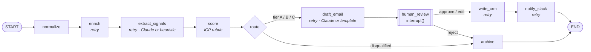
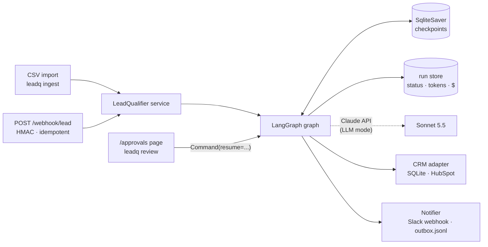

# leadq: inbound lead qualifier agent with human-in-the-loop approval

**A LangGraph agent that enriches, scores and drafts replies to inbound leads, then waits for a human to approve
before anything reaches your CRM or Slack.** It checkpoints every run to SQLite, retries flaky network and LLM calls,
tracks the exact token cost of each lead, and ships with an eval suite.

 
 

- **Ingest** from a CSV or a signed, idempotent webhook (`POST /webhook/lead`).
- **Enrich** each lead by fetching the company homepage (offline fixtures by default, `--live` for real HTTP).
- **Extract** firmographics and buying intent with Claude structured outputs, or a deterministic offline heuristic.
- **Score** against a YAML ICP rubric. The scoring is deterministic and every point comes with a reason.
- **Draft** a personalised, tier-appropriate reply.
- **Pause for approval** with LangGraph `interrupt()`. Approve, edit or reject from the CLI or a small web page.
- **Write** approved leads to a CRM (SQLite mock or HubSpot mapping) and post a Slack Block Kit summary.

## How it works





A run that pauses at `human_review` is persisted in `var/checkpoints.sqlite` under a deterministic `thread_id`
derived from the lead's email and company. You can stop the process, restart it a day later, and approve the run
from the CLI or the web page. The graph resumes exactly where it stopped.

## Quickstart

Requires [uv](https://docs.astral.sh/uv/). No API key is needed.

```bash
make demo        # uv sync, reset local state, qualify data/leads.sample.csv offline
make serve       # http://127.0.0.1:8000/approvals
```

Then, in another terminal:

```bash
uv run leadq pending                  # runs paused at human review
uv run leadq review <thread_id>       # approve / [e]dit (opens $EDITOR) / reject
uv run leadq crm                      # contacts, deals and notes the approval wrote
uv run leadq outbox                   # the Slack Block Kit message (outbox/slack.jsonl)
uv run leadq runs                     # status, tokens and cost per run
```

Send a lead to the webhook. If `WEBHOOK_SECRET` is set, sign the raw body:

```bash
BODY='{"name":"Aoife Byrne","email":"aoife@quillstack.example","company":"Quillstack","website":"https://quillstack.example","message":"Our Zendesk queue is triaged by hand every morning. Can we book a call this week?"}'
SIG="sha256=$(printf '%s' "$BODY" | openssl dgst -sha256 -hmac "$WEBHOOK_SECRET" | sed 's/^.* //')"
curl -X POST localhost:8000/webhook/lead -H 'content-type: application/json' -H "X-Leadq-Signature: $SIG" -d "$BODY"
# -> 202 {"thread_id":"lead-…","status":"queued",...}; posting it again returns 200 {"duplicate":true}
```

Other commands: `make test`, `make eval`, `make eval-llm`, `make reset`, `uv run leadq --help`.

## Offline mode vs. LLM mode

| | Offline (default with no key) | LLM (`ANTHROPIC_API_KEY` in `.env`) |
|---|---|---|
| Signal extraction | Keyword/regex heuristics (`heuristics.py`) | `claude-sonnet-5-5` structured output into the same `SignalsCore` Pydantic model, `effort: low` |
| Email draft | Tier-aware template grounded in the homepage and message | `claude-sonnet-5-5` structured output (`EmailDraft`), `effort: medium` |
| Scoring, routing, HITL, CRM, Slack | identical | identical |
| Cost | $0 | exact per node, from `response.usage` |

`--mode auto` (the default) picks LLM mode when a key is present. `--mode llm` without a key fails immediately
with a message telling you to add `ANTHROPIC_API_KEY` to `.env`. Every screen labels which mode produced a run.

How Claude is called (`src/leadq/llm.py`, using the official `anthropic` SDK directly inside the graph nodes):

- `client.messages.parse(output_format=<PydanticModel>, output_config={"effort": ...})`. Structured outputs
  replace prefill and JSON parsing hacks. No `temperature`, `top_p`, `top_k` or thinking budget is sent.
- `stop_reason == "refusal"` is checked before any content is read. A refusal, truncation or unparseable output
  falls back to the heuristic extractor or the template, and the cost of the failed call is still recorded.
- Sonnet requests opt into server-side refusal fallback (`betas=["server-side-fallback-2026-07-01"]`,
  `fallbacks="default"`), which you can turn off with `CLAUDE_FALLBACKS=off`. Haiku requests never send it.
  When a fallback model serves a request, each attempt in `usage.iterations` is priced at its own model's rate.
- Lead messages and homepages are untrusted. They are wrapped in tags and the model is told to treat them as data.
- Models can be overridden with `CLAUDE_MODEL` and `CLAUDE_JUDGE_MODEL`. Costs use list prices: Sonnet 5.5 at
  $2/$10 and Haiku 5.5 at $0.10/$0.50 per million input/output tokens.

## The ICP rubric

`config/icp.yaml` holds the scoring logic. Each criterion reads one extracted signal and awards
`weight × credit` points. The total is normalised to 0-100. Hard disqualifiers override the score, and tier caps
limit the best possible tier.

```yaml
tiers: {A: 75, B: 50, C: 30}          # below C -> disqualified (poor fit)

criteria:
  company_size:
    field: employee_band
    kind: match                      # match | levels | multi
    weight: 15
    target: ["11-50", "51-200", "201-500"]
    partial: ["501-1000", "1001+"]   # half credit
  buying_intent:
    field: buying_intent
    kind: levels
    weight: 25
    levels: {high: 1.0, medium: 0.6, low: 0.2, none: 0.0}

disqualifiers:                       # any hit -> tier "disqualified"
  competitor:
    description: An AI/automation agency or consultancy that sells the same services we do.   # given to Claude
    keywords: [ai automation agency, automation consultancy, ...]                              # used offline

tier_caps:
  - {field: employee_band, values: ["1-10"], max_tier: C, reason: "Below minimum company size"}
```

Each scored lead carries a per-criterion breakdown, for example `company_size 15/15: 51-200 is a target employee
band`. It appears in the CLI, the approval page, the CRM note and the Slack message.

## Production concerns

| Concern | How it is handled |
|---|---|
| Human in the loop | `interrupt()` in `human_review`. The reviewer sees the lead, the score breakdown and an editable draft, and resumes with `Command(resume={"action": "approve" \| "edit" \| "reject", ...})`. Edits are recorded as `edit`. |
| Durability | `SqliteSaver` checkpoints after every node. Pending runs survive restarts, and a failed run continues from its last checkpoint with `leadq retry <thread>`. |
| Retries | `RetryPolicy` with exponential backoff on `enrich`, `extract_signals`, `draft_email`, `write_crm` and `notify_slack`. Predicates retry only transient errors (timeouts, connection errors, 429, 5xx), never 4xx or refusals. |
| Idempotency | `thread_id = sha256(email + company)`. The webhook and CSV ingest skip leads they have already seen. CRM writes upsert on email, and deals and notes are keyed by thread. |
| Webhook security | Pydantic validation (422 on bad input) and an optional HMAC-SHA256 signature in `X-Leadq-Signature` (401 if missing or wrong). The webhook responds 202 immediately and runs the graph in the background. |
| Cost tracking | Per-node `UsageRecord`s accumulate in graph state through a reducer and are persisted per run. `leadq runs` and the approval page show the totals. |
| Untrusted input | Prompt-injection framing for the LLM. The web UI autoescapes HTML and the CLI escapes rich markup. |
| Adapters | `CRM` ABC (`SQLiteCRM`, `HubSpotCRM`) and `Notifier` ABC (`SlackWebhookNotifier`, `OutboxNotifier`). |

## Screenshots

> _Placeholders: add these after recording the demo._
>
> - `docs/approvals.png`: approval page with score breakdown and editable draft
> - `docs/cli-ingest.png`: `leadq ingest` table with tiers and cost
> - `docs/slack.png`: Block Kit message rendered in Slack

## Evals

`evals/leads.jsonl` contains 20 synthetic leads for fictional `.example` companies, each with a homepage fixture
and an expected tier: 6 A, 5 B, 4 C and 5 disqualified. Several are deliberately tricky: a great company whose
sender is a student, a competitor with budget, strong intent from a three-person company, and an ideal-ICP company
that sent a vague message. The labels were committed before the scorer ever ran on them. Full methodology,
confusion matrices and error analysis are in [EVAL_REPORT.md](EVAL_REPORT.md).

| Mode | Tier accuracy | Macro-F1 | Drafts passing all 7 email checks | LLM judge (1-5) | Cost / lead |
|---|---|---|---|---|---|
| Offline (heuristics + template) | 0.55 (11/20) | 0.54 | 12/15 (80%) | not run | $0.00 |
| LLM (Claude Sonnet 5.5) | pending: run `make eval-llm` with `ANTHROPIC_API_KEY` set | pending | pending | pending | pending |

The offline extractor is a held-out baseline, and its misses are all phrasing it was never tuned on. For example,
it reads "two of us spend two hours" as a two-person company and does not recognise "boutique AI consultancy" as a
competitor. The eval also caught a grounding bug in the template ("Since you mentioned HubSpot" when HubSpot was
only detected on the homepage). That bug is fixed, and a check now guards against it.

To run the LLM evals:

```bash
cp .env.example .env    # add ANTHROPIC_API_KEY
make eval-llm           # Claude extraction + drafting on all 20 leads, Haiku 5.5 judge; report regenerated
```

## Adapting this for your business

1. **Rubric**: edit `config/icp.yaml` (seller description, target industries and sizes, weights, thresholds,
   disqualifier descriptions and keywords, tier caps). No code changes are needed. `tests/test_rubric.py` shows how
   to validate it.
2. **CRM**: set `LEADQ_CRM=hubspot` and `HUBSPOT_TOKEN` to use the HubSpot v3 mapping (contacts batch upsert,
   deals and notes with associations). Without a token it runs dry and logs payloads to
   `outbox/hubspot_dryrun.jsonl`. For another CRM, implement the three methods of the `CRM` ABC in
   `src/leadq/adapters/crm.py`.
3. **Notifications**: set `SLACK_WEBHOOK_URL` to post Block Kit messages, or implement `Notifier.send()` for Teams,
   email and so on.
4. **Lead sources**: point your form tool (Typeform, Webflow, HubSpot forms, Zapier) at `POST /webhook/lead`, or
   export a CSV.
5. **Signals**: the enums live in `src/leadq/models.py`. Add an industry or disqualifier name there and the LLM
   schema follows automatically. For offline mode, also add keywords to `heuristics.py` (industries) or to
   `icp.yaml` (disqualifiers).

## Project layout

```
src/leadq/
  graph.py         LangGraph state, nodes, retry policies, interrupt
  service.py       LeadQualifier: wiring, submit/resume/retry, run sync
  llm.py           Claude client (structured outputs, refusal, fallbacks), pricing, usage records
  prompts.py       extraction + drafting prompts (untrusted-input framing)
  heuristics.py    offline signal extractor
  rubric.py        YAML rubric model + deterministic scoring
  enrich.py        fixture/live fetchers, HTML parsing
  drafting.py      offline template drafts
  adapters/        CRM (SQLite, HubSpot) and Notifier (Slack, outbox)
  store.py         run registry (status, tokens, cost)
  cli.py           `leadq` CLI (typer + rich)
  web/             FastAPI webhook, JSON API, /approvals page
config/icp.yaml    the rubric
data/              sample leads (development set)
fixtures/sites/    offline homepages for sample + eval leads
evals/             eval set, runner, checks, LLM judge, saved results
tests/             pytest suite (offline, no network)
```

## Limitations

- The offline heuristic is a baseline, not a product. Use LLM mode for real traffic, and see EVAL_REPORT.md for
  where the heuristic fails.
- The LLM path has unit tests against a fake client, but this repository contains no live LLM eval numbers yet.
- Live homepage fetching reads a single page (no crawling or JavaScript rendering).
- The web approval page has no authentication. Put it behind your SSO or VPN before exposing it.

## License

MIT © 2026 Shubham Garje. See [LICENSE](LICENSE).
